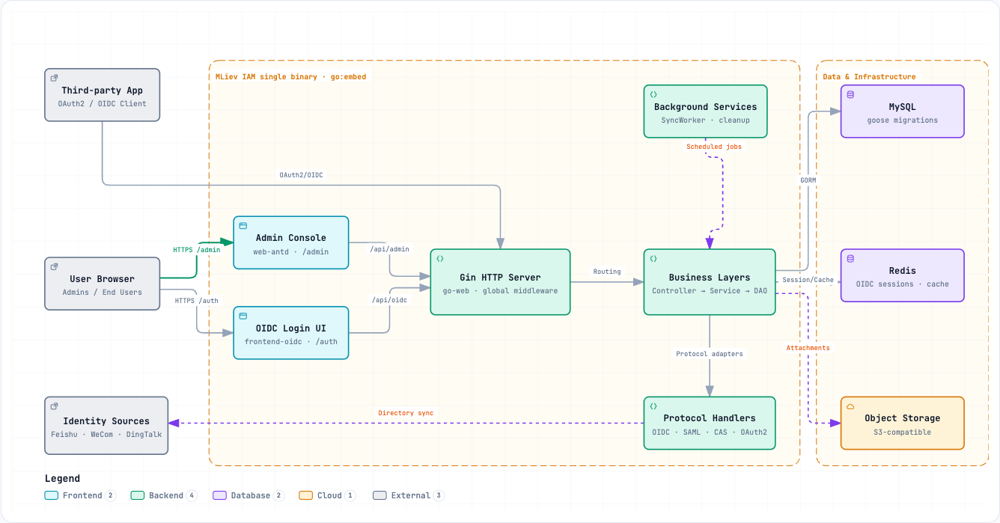

# MLiev IAM

[](LICENSE)
[](https://go.dev)

English | [简体中文](README.zh-CN.md)

Enterprise identity and access management (IAM) with single sign-on — a complete
OIDC / OAuth2 provider built in Go, shipping an embedded admin console and login UI,
fine-grained RBAC, and enterprise directory integration in a single binary.

## Features

- **OIDC / OAuth2 provider** — authorization-code flow with PKCE, token introspection and revocation, JWKS, and discovery; applications can also register as SAML, CAS, or plain OAuth2 clients
- **Two-factor authentication** — Optional TOTP, SMS and email verification across all login entrypoints, with single-use recovery codes and audited administrator resets. [Deployment and API guide (中文)](docs/two-factor-authentication.zh-CN.md)
- **Single sign-on** — one identity hub for all your applications, served under `/oidc/:client_id/*`
- **Social login** — Google, GitHub, QQ, WeChat, WeChat Mini Program, and generic OAuth2/OIDC identity sources
- **Enterprise directory sync** — Feishu (Lark), WeCom, and DingTalk directories with event callbacks and sync automation
- **RBAC with data scope** — roles, menu/button/API permissions, and four-level row-level data scoping
- **Embedded frontends** — a Vben + Ant Design Vue admin console at `/admin` and a dedicated Vue 3 login/consent app at `/auth`, both baked into the binary via `go:embed`
- **Flexible storage** — MySQL (default), MariaDB (using the MySQL driver), PostgreSQL, or SQLite with goose versioned SQL migrations that run automatically at startup; Redis for sessions and caching; S3-compatible object storage for attachments
- **Hot reload** — reload configuration via `SIGHUP` or the admin API without restarting the process
- **Guided installation** — a built-in setup wizard (license → database → Redis → admin) with no separate frontend to build
- **Single-binary deployment** — templates and static assets are embedded; debug mode serves them from disk for hot reloading

## Architecture

Interactive architecture diagrams — generated with [Archify](https://github.com/tt-a1i/archify), available in Chinese and English, with dark/light themes, zoom, search, and PNG/SVG export. Index: [docs/archify](docs/archify/README.md).



| Diagram | 中文 | English |
|---|---|---|
| System architecture | [中文](docs/archify/zh-CN/system-architecture.html) | [English](docs/archify/en/system-architecture.html) |
| OIDC authorization-code flow | [中文](docs/archify/zh-CN/oidc-authorization-flow.html) | [English](docs/archify/en/oidc-authorization-flow.html) |
| HTTP request lifecycle | [中文](docs/archify/zh-CN/request-lifecycle.html) | [English](docs/archify/en/request-lifecycle.html) |
| Boot & assembly workflow | [中文](docs/archify/zh-CN/boot-assembly.html) | [English](docs/archify/en/boot-assembly.html) |

In short: two frontend apps (`admin-web` → `/admin`, `frontend-oidc` → `/auth`) are served by a
Gin server built on the [go-web](https://cnb.cool/mliev/open/go-web) framework. A global middleware
chain (traceId → access log → recovery → CORS → install gate) fronts route groups guarded by JWT
auth middleware; requests then flow through Controller → Service → DAO layers over GORM to the
database, with Redis backing OIDC sessions and the settings cache. Protocol handlers for
OIDC/SAML/CAS/OAuth2 plus directory, social, and event adapters live in `app/service/protocol/`.
See [OIDC_README.md](OIDC_README.md) for protocol details.

## Quick Start

### Prerequisites

- Go 1.26+
- MySQL 8+ / PostgreSQL 13+ / SQLite 3+
- Redis 6+

### Clone, configure, and run

```bash
# frontends are git submodules
git clone --recurse-submodules https://cnb.cool/mliev/iam/mliev-iam.git
cd mliev-iam

cp config.yaml.example config.yaml    # edit database / Redis settings

# OIDC signing keys (skip if you manage keys another way)
openssl genrsa -out keys/oidc_private_key.pem 2048
openssl rsa -in keys/oidc_private_key.pem -pubout -out keys/oidc_public_key.pem

go run . start                        # start the backend (gomander process
                                      # manager: start | stop | restart | reload | status)
```

Other common workflows (see the `Makefile` for the full list):

```bash
make dev        # frontend watch + Go backend in debug mode
make all        # build frontends + Go backend
make build-go   # Go backend only
```

### Docker

```bash
docker build -t mliev-iam .
docker run -p 8080:8080 mliev-iam
```

### First-time install

On first launch the app does not require a configured database or Redis: open `/install/` and
follow the embedded wizard (license agreement → database → Redis → admin account). The wizard is
provided by setup-kit inside the binary, so there is no separate installer frontend. For
API-driven installation, TLS options, and backup notes, see the detailed guide:
[docs/installation-guide.zh-CN.md](docs/installation-guide.zh-CN.md) (Chinese).

## Configuration & Hot Reload

Reload configuration at runtime without restarting the process:

```bash
kill -HUP <PID>              # via signal
./scripts/reload-config.sh   # via the admin API (requires an admin token)
```

Details in the [configuration reload guide](_docs/CONFIG_RELOAD_GUIDE.md).

## Documentation

- [Architecture diagrams](docs/archify/README.md) — interactive, bilingual
- [OIDC protocol reference](OIDC_README.md)
- [Development standards](_docs/PROJECT_SPECIFICATION.md)
- [JWT authentication guide](_docs/JWT_AUTHENTICATION_GUIDE.md)
- [RBAC technical implementation](_docs/RBAC_TECHNICAL_IMPLEMENTATION.md)
- [Testing guide](_docs/TESTING_GUIDE.md)
- [Docker deployment notes](_docs/docker/)
- [First-time installation guide](docs/installation-guide.zh-CN.md) (Chinese)

## Project Structure

```
mliev-iam/
├── app/            # controllers, services, DAOs, models, DTOs, middleware
├── config/         # app assembly and autoload config providers
├── internal/       # JWT key management, credential crypto, password hashing
├── pkg/            # extension modules, installation state, credentials
├── migrations/     # goose versioned SQL migrations (mysql / postgresql / sqlite)
├── admin-web/      # admin console frontend (submodule → static/admin → /admin)
├── frontend-oidc/  # OIDC login UI frontend (submodule → static/auth → /auth)
├── static/         # embedded static assets (populated by frontend builds)
├── templates/      # embedded HTML templates
├── docs/           # architecture diagrams and guides
└── _docs/          # engineering docs (specs, guides, reports)
```

## Contributing

1. Fork the repository
2. Create a feature branch
3. Commit your changes
4. Open a pull request

Please follow the [development standards](_docs/PROJECT_SPECIFICATION.md).

## Upgrade Notes

Migration `20260922000001` lets `client_credentials` applications request access tokens
repeatedly (the refresh token column is stored as `NULL` for machine tokens). Back up your
database and stop old nodes before upgrading — the migration cannot be rolled back with
`goose Down`. Details: [docs/oidc-machine-token-upgrade.zh-CN.md](docs/oidc-machine-token-upgrade.zh-CN.md) (Chinese).

## License

Released under the [MIT License](LICENSE).

---

© 2026 MLiev IAM
