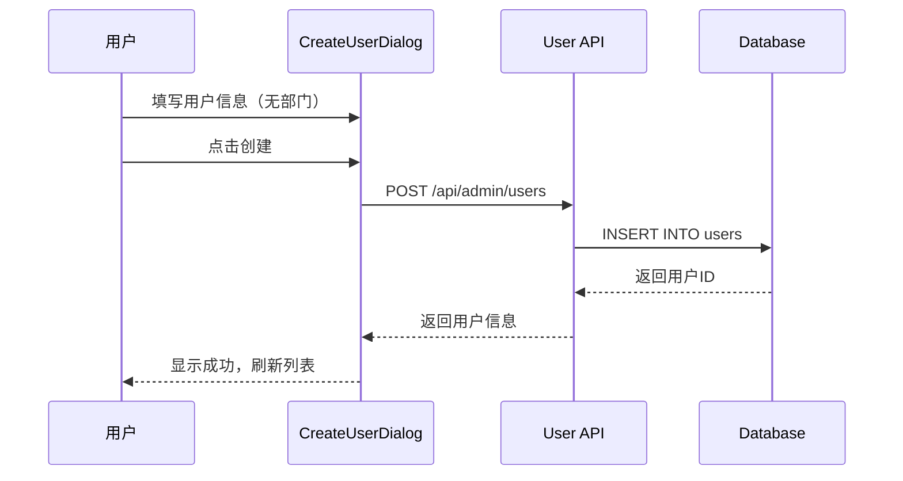
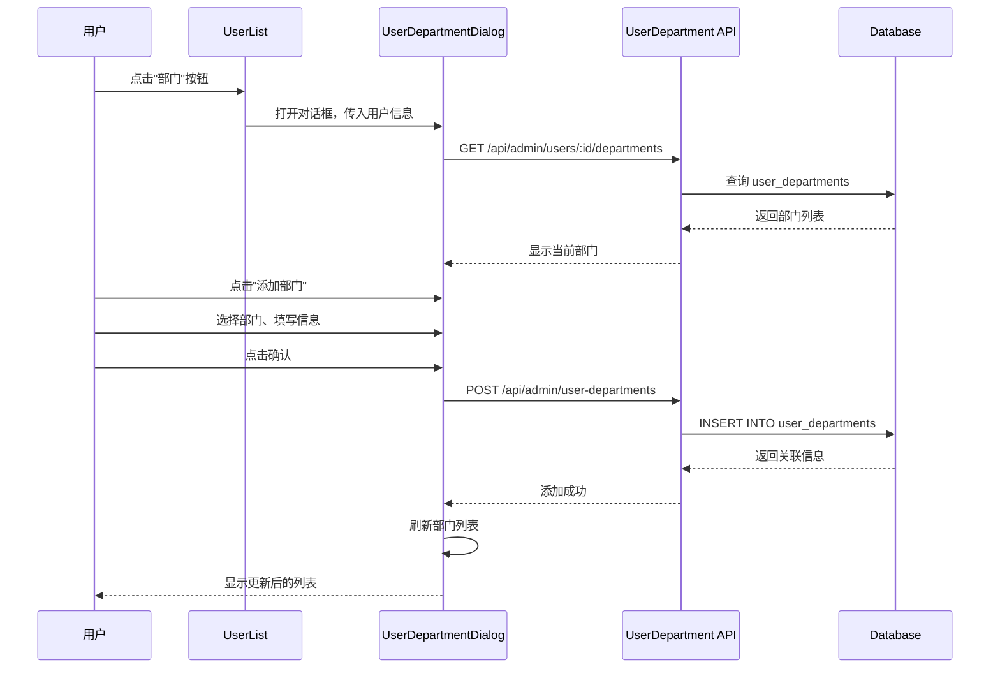

# 前端用户部门关联重构适配总结

## 概述

本文档总结了前端部分为适配新的用户-部门关联架构所做的调整。后端已将用户和部门的直接外键关系改为独立的关联表（`user_departments`），前端需要相应地调整 API 调用和组件逻辑。

## 变更目标

1. **移除直接部门关联**：从用户创建和编辑流程中移除 `departmentId` 字段
2. **独立部门管理**：提供专门的界面管理用户和部门的关联关系
3. **支持多部门**：一个用户可以关联多个部门，并设置主部门
4. **灵活的关联信息**：支持职位、部门类型（成员/负责人）等扩展信息

## 文件变更清单

### 1. 新增文件

#### API 层
- **`src/api/core/user-department.ts`** (233行)
  - 用户部门关联管理的完整 API 定义
  - 包含 TypeScript 类型定义和所有 CRUD 操作
  - 支持批量操作、主部门设置等高级功能

#### 组件层
- **`src/views/user-management/components/UserDepartmentDialog.vue`** (430行)
  - 用户部门关联管理的主对话框组件
  - 显示用户当前的所有部门
  - 支持添加、删除部门关联
  - 支持设置主部门

#### 图标
- **`packages/icons/src/iconify/index.ts`** (更新)
  - 添加 `Building2` 图标用于表示部门

### 2. 修改文件

#### API 类型定义
**`src/api/core/user-management.ts`**

修改前：
```typescript
export interface CreateUserParams {
  username: string;
  email?: string;
  // ...
  departmentId?: number;  // ❌ 直接关联部门
  remark?: string;
}
```

修改后：
```typescript
export interface CreateUserParams {
  username: string;
  email?: string;
  // ...
  remark?: string;  // ✅ 移除 departmentId
}
```

同样的修改应用于：
- `UpdateUserParams`
- `UserQueryParams`
- `UserResponse`

#### 用户创建组件
**`src/views/user-management/components/CreateUserDialog.vue`**

变更点：
1. 移除了 `departmentId` 表单字段
2. 移除了部门选择下拉框
3. 更新表单数据结构，去除 `departmentId`
4. 添加提示信息："创建用户后，可在用户列表中为其分配部门"

修改前：
```vue
<FormItem label="所属部门" name="departmentId" class="md:col-span-1">
  <Select
    v-model:value="formData.departmentId"
    placeholder="请选择部门"
    allow-clear
  >
    <SelectOption v-for="dept in departmentOptions" ...>
      {{ dept.label }}
    </SelectOption>
  </Select>
</FormItem>
```

修改后：
```vue
<FormItem label="昵称" name="nickname" class="md:col-span-2">
  <Input v-model:value="formData.nickname" placeholder="请输入昵称" />
  <div class="mt-1 text-xs text-gray-500">
    创建用户后，可在用户列表中为其分配部门
  </div>
</FormItem>
```

#### 用户编辑组件
**`src/views/user-management/components/EditUserDialog.vue`**

变更点：
1. 移除了 `departmentId` 表单字段
2. 移除了部门选择下拉框
3. 移除了部门选项数据
4. 添加提示信息："部门管理请使用'部门'按钮单独配置"

修改前：
```typescript
const formData = reactive<UpdateUserParams & { username: string }>({
  username: '',
  email: '',
  phone: '',
  nickname: '',
  realName: '',
  departmentId: undefined,  // ❌ 部门ID
  remark: '',
});
```

修改后：
```typescript
const formData = reactive<UpdateUserParams & { username: string }>({
  username: '',
  email: '',
  phone: '',
  nickname: '',
  realName: '',
  remark: '',  // ✅ 移除部门ID
});
```

#### 用户列表页面
**`src/views/user-management/user-list/index.vue`**

变更点：
1. 添加 `Building2` 图标导入
2. 添加 `UserDepartmentDialog` 组件导入
3. 添加 `userDepartmentDialogVisible` 状态管理
4. 在操作列添加"部门"按钮
5. 添加 `department` 操作处理逻辑
6. 添加用户部门管理对话框

修改前：
```vue
<template>
  ...
  <Button size="small" type="link" @click="handleUserAction('edit', record)">
    编辑
  </Button>
  <Button size="small" type="link" @click="handleUserAction('role', record)">
    <Settings class="mr-1 h-4 w-4" />
    角色
  </Button>
  ...
</template>
```

修改后：
```vue
<template>
  ...
  <Button size="small" type="link" @click="handleUserAction('edit', record)">
    编辑
  </Button>
  <Button size="small" type="link" @click="handleUserAction('department', record)">
    <Building2 class="mr-1 h-4 w-4" />
    部门
  </Button>
  <Button size="small" type="link" @click="handleUserAction('role', record)">
    <Settings class="mr-1 h-4 w-4" />
    角色
  </Button>
  ...
  
  <!-- 用户部门管理对话框 -->
  <UserDepartmentDialog
    v-model:visible="userDepartmentDialogVisible"
    :user="currentUser"
    @confirm="handleDialogRefresh"
    @cancel="userDepartmentDialogVisible = false"
  />
</template>
```

## 新增 API 接口定义

### 用户部门关联 API (`user-department.ts`)

#### 类型定义

```typescript
export namespace UserDepartmentApi {
  /** 用户部门类型枚举 */
  export type UserDepartmentType = 0 | 1 | 2; 
  // 0: 成员, 1: 负责人, 2: 副负责人

  /** 创建用户部门关联请求参数 */
  export interface CreateUserDepartmentParams {
    userId: number;
    departmentId: number;
    position?: string;        // 职位
    title?: string;           // 职称
    type?: UserDepartmentType;
    isPrimary?: boolean;      // 是否主部门
    sort?: number;
    remark?: string;
  }

  /** 用户部门关联响应信息 */
  export interface UserDepartmentResponse {
    userId: number;
    departmentId: number;
    position: string;
    title: string;
    type: UserDepartmentType;
    typeName: string;
    isActive: boolean;
    isPrimary: boolean;       // 是否主部门
    sort: number;
    joinedAt?: string;        // 加入时间
    leftAt?: string;          // 离开时间
    remark: string;
    department?: DepartmentInfo;
    user?: UserInfo;
    createdAt: string;
    updatedAt: string;
  }
}
```

#### API 方法

| 方法 | 接口 | 说明 |
|------|------|------|
| `createUserDepartmentApi` | `POST /api/admin/user-departments` | 创建用户部门关联 |
| `updateUserDepartmentApi` | `PUT /api/admin/user-departments/:userId/:deptId` | 更新关联信息 |
| `deleteUserDepartmentApi` | `DELETE /api/admin/user-departments/:userId/:deptId` | 删除关联 |
| `getUserDepartmentsApi` | `GET /api/admin/users/:userId/departments` | 获取用户的所有部门 |
| `getDepartmentUsersApi` | `GET /api/admin/departments/:deptId/users` | 获取部门的所有用户 |
| `setPrimaryDepartmentApi` | `PUT /api/admin/users/:userId/departments/:deptId/primary` | 设置主部门 |
| `batchAddUserDepartmentsApi` | `POST /api/admin/user-departments/batch` | 批量添加 |
| `batchDeleteUserDepartmentsApi` | `DELETE /api/admin/users/:userId/departments/batch` | 批量删除 |

## 用户部门管理对话框功能详解

### UserDepartmentDialog 组件

#### 主要功能
1. **显示用户部门列表**
   - 展示用户当前关联的所有部门
   - 显示部门名称、编码、职位、类型等信息
   - 标识主部门

2. **添加部门关联**
   - 弹出子对话框选择部门
   - 设置职位、类型（成员/负责人/副负责人）
   - 可选择是否设为主部门

3. **管理部门关联**
   - 设置主部门（每个用户只能有一个主部门）
   - 删除部门关联
   - 查看加入时间等详细信息

#### 界面布局

```
┌─────────────────────────────────────────────────────────┐
│ 用户部门管理                                    [关闭] [确定] │
├─────────────────────────────────────────────────────────┤
│ 用户：admin (系统管理员)  邮箱：admin@example.com          │
├─────────────────────────────────────────────────────────┤
│ 部门列表                                      [+ 添加部门] │
│ ┌─────────────────────────────────────────────────────┐ │
│ │ 部门名称 │ 部门编码 │ 职位 │ 类型 │ 主部门 │ 操作    │ │
│ ├─────────────────────────────────────────────────────┤ │
│ │ 技术部   │ tech    │ 工程师│ 成员 │ ✓主部门│ 删除    │ │
│ │ 产品部   │ product │      │ 成员 │    -   │设为主部门│ │
│ └─────────────────────────────────────────────────────┘ │
└─────────────────────────────────────────────────────────┘
```

#### 添加部门对话框

```
┌─────────────────────────────────┐
│ 添加部门                [取消] [确定] │
├─────────────────────────────────┤
│ 选择部门 *                       │
│ [下拉选择部门列表...]             │
│                                 │
│ 职位                            │
│ [请输入职位名称]                 │
│                                 │
│ 类型                            │
│ [普通成员 ▼]                    │
│                                 │
│ 设为主部门                       │
│ [开关] 主部门将作为用户的默认部门  │
└─────────────────────────────────┘
```

## 用户操作流程变更

### 旧流程：创建用户时直接分配部门

```
1. 打开"新增用户"对话框
2. 填写用户信息
3. 选择所属部门 ← 在创建时指定
4. 点击创建
```

### 新流程：创建用户后单独管理部门

```
步骤1：创建用户
1. 打开"新增用户"对话框
2. 填写用户基本信息（无部门选项）
3. 点击创建

步骤2：分配部门（可选，支持多部门）
1. 在用户列表中找到刚创建的用户
2. 点击"部门"按钮
3. 在部门管理对话框中点击"添加部门"
4. 选择部门、填写职位、选择类型
5. 可选择是否设为主部门
6. 确认添加
7. 可继续添加更多部门
```

## UI/UX 改进

### 1. 清晰的操作分离
- **创建用户**：专注于用户基本信息
- **部门管理**：通过独立按钮单独管理
- **角色管理**：保持独立按钮

### 2. 多部门支持
- 一个用户可以关联多个部门
- 清晰标识主部门
- 支持设置职位和类型

### 3. 灵活的管理方式
- 支持随时添加/删除部门关联
- 支持切换主部门
- 保留历史信息（加入时间等）

## 数据流程

### 创建用户流程



### 分配部门流程



## 兼容性说明

### 与后端 API 的对应关系

| 前端方法 | 后端路由 | 后端 Controller 方法 |
|---------|---------|---------------------|
| `createUserDepartmentApi` | `POST /api/admin/user-departments` | 待实现 |
| `getUserDepartmentsApi` | `GET /api/admin/users/:id/departments` | 待实现 |
| `deleteUserDepartmentApi` | `DELETE /api/admin/user-departments/:userId/:deptId` | 待实现 |
| `setPrimaryDepartmentApi` | `PUT /api/admin/users/:id/departments/:deptId/primary` | 待实现 |

> **注意**：后端需要创建对应的 Controller 来处理这些请求。

## 后续待实现功能

### 后端 Controller 层

需要创建 `UserDepartmentController`，提供以下接口：

```go
// app/controller/admin/user_department_controller.go

type UserDepartmentController struct{}

// 创建用户部门关联
// POST /api/admin/user-departments
func (c *UserDepartmentController) Create(ctx *gin.Context) {}

// 更新用户部门关联
// PUT /api/admin/user-departments/:userId/:departmentId
func (c *UserDepartmentController) Update(ctx *gin.Context) {}

// 删除用户部门关联
// DELETE /api/admin/user-departments/:userId/:departmentId
func (c *UserDepartmentController) Delete(ctx *gin.Context) {}

// 查询用户部门关联列表
// GET /api/admin/user-departments
func (c *UserDepartmentController) List(ctx *gin.Context) {}

// 获取用户的所有部门
// GET /api/admin/users/:userId/departments
func (c *UserDepartmentController) GetUserDepartments(ctx *gin.Context) {}

// 获取部门的所有用户
// GET /api/admin/departments/:departmentId/users
func (c *UserDepartmentController) GetDepartmentUsers(ctx *gin.Context) {}

// 设置主部门
// PUT /api/admin/users/:userId/departments/:departmentId/primary
func (c *UserDepartmentController) SetPrimaryDepartment(ctx *gin.Context) {}

// 批量添加
// POST /api/admin/user-departments/batch
func (c *UserDepartmentController) BatchCreate(ctx *gin.Context) {}

// 批量删除
// DELETE /api/admin/users/:userId/departments/batch
func (c *UserDepartmentController) BatchDelete(ctx *gin.Context) {}
```

### 路由注册

```go
// config/autoload/router.go

// 用户部门关联管理
userDept := admin.Group("/user-departments")
userDept.Use(middleware.RbacMiddleware(helper))
{
    userDeptController := AdminController.UserDepartmentController{}
    
    userDept.POST("", deps.WrapHandler(userDeptController.Create))
    userDept.PUT("/:userId/:departmentId", deps.WrapHandler(userDeptController.Update))
    userDept.DELETE("/:userId/:departmentId", deps.WrapHandler(userDeptController.Delete))
    userDept.GET("", deps.WrapHandler(userDeptController.List))
    userDept.POST("/batch", deps.WrapHandler(userDeptController.BatchCreate))
}

// 用户相关路由中添加
users.GET("/:id/departments", deps.WrapHandler(userController.GetUserDepartments))
users.PUT("/:id/departments/:deptId/primary", deps.WrapHandler(userController.SetPrimaryDepartment))
users.DELETE("/:id/departments/batch", deps.WrapHandler(userController.BatchDeleteDepartments))
```

### Service 层

创建 `UserDepartmentService`：

```go
// app/service/user_department_service.go

type UserDepartmentService struct {
    userDeptDao *dao.UserDepartmentDao
    database    *gorm.DB
}

func NewUserDepartmentService(database *gorm.DB) *UserDepartmentService {
    return &UserDepartmentService{
        userDeptDao: dao.NewUserDepartmentDao(database),
        database:    database,
    }
}

// 实现业务逻辑方法...
```

## 测试建议

### 前端测试

1. **用户创建测试**
   - 验证创建用户时不再需要选择部门
   - 验证创建成功后可以正常显示在列表中

2. **部门管理测试**
   - 验证点击"部门"按钮能打开部门管理对话框
   - 验证能正常显示用户当前的部门列表
   - 验证能添加新的部门关联
   - 验证能删除部门关联
   - 验证能设置主部门
   - 验证主部门标识显示正确

3. **多部门场景测试**
   - 为一个用户添加多个部门
   - 切换主部门
   - 验证数据正确保存和显示

4. **边界情况测试**
   - 用户没有任何部门
   - 用户只有一个部门
   - 删除最后一个部门

### 集成测试

1. **前后端联调**
   - 验证 API 请求格式正确
   - 验证响应数据格式匹配
   - 验证错误处理

2. **数据一致性**
   - 创建关联后立即查询，验证数据正确
   - 设置主部门后验证其他部门的 `isPrimary` 状态更新

## 迁移指南

### 对于现有用户数据

如果系统中已有用户数据：

1. **数据迁移**（后端完成）
   ```sql
   -- 将现有的 department_id 迁移到 user_departments 表
   INSERT INTO user_departments (
     user_id, department_id, type, is_active, is_primary, 
     joined_at, created_at, updated_at
   )
   SELECT 
     id, department_id, 0, 1, 1, 
     created_at, NOW(), NOW()
   FROM users 
   WHERE department_id IS NOT NULL;
   ```

2. **前端无需特殊处理**
   - 前端会自动通过新的 API 获取部门信息
   - 用户看到的是迁移后的数据

### 对于开发人员

1. **更新依赖**
   ```bash
   cd admin-web
   pnpm install  # 确保所有依赖最新
   ```

2. **重启开发服务器**
   ```bash
   pnpm dev
   ```

3. **清除浏览器缓存**
   - 按 `Cmd+Shift+R` (Mac) 或 `Ctrl+Shift+R` (Windows/Linux)
   - 或手动清除缓存

## 注意事项

1. **图标依赖**
   - 新增了 `Building2` 图标（`lucide:building-2`）
   - 确保 iconify 可以访问外网资源

2. **权限控制**
   - 部门管理功能需要相应的 RBAC 权限
   - 确保当前用户有用户管理权限

3. **性能考虑**
   - 用户列表不再包含部门信息，减少了数据量
   - 部门信息通过独立接口按需加载

4. **用户体验**
   - 创建用户流程变简单了
   - 部门管理更加灵活和直观

## 总结

本次前端适配完整实现了以下目标：

✅ **架构解耦**：用户创建与部门分配完全解耦  
✅ **多部门支持**：支持一个用户关联多个部门  
✅ **灵活管理**：提供独立的部门管理界面  
✅ **类型安全**：完整的 TypeScript 类型定义  
✅ **用户友好**：清晰的操作流程和界面反馈  

这种设计模式更符合现代 SaaS 应用的架构要求，为未来的功能扩展（如矩阵式组织、虚拟团队等）提供了良好的基础。
