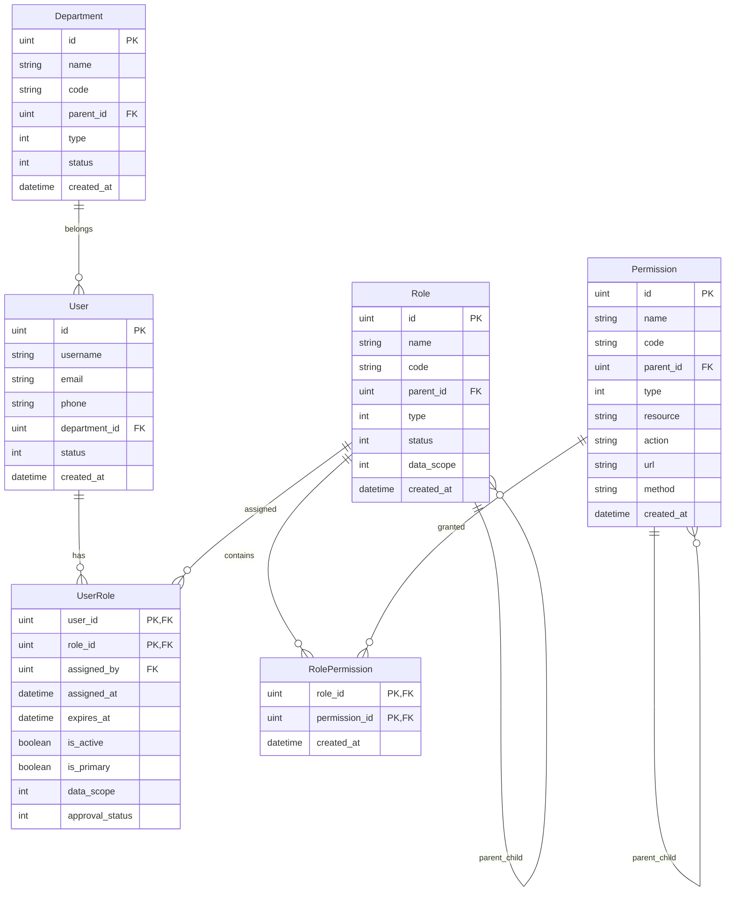
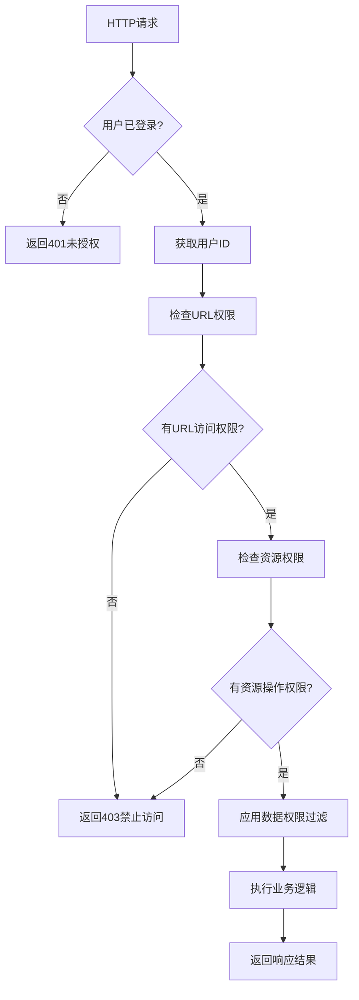
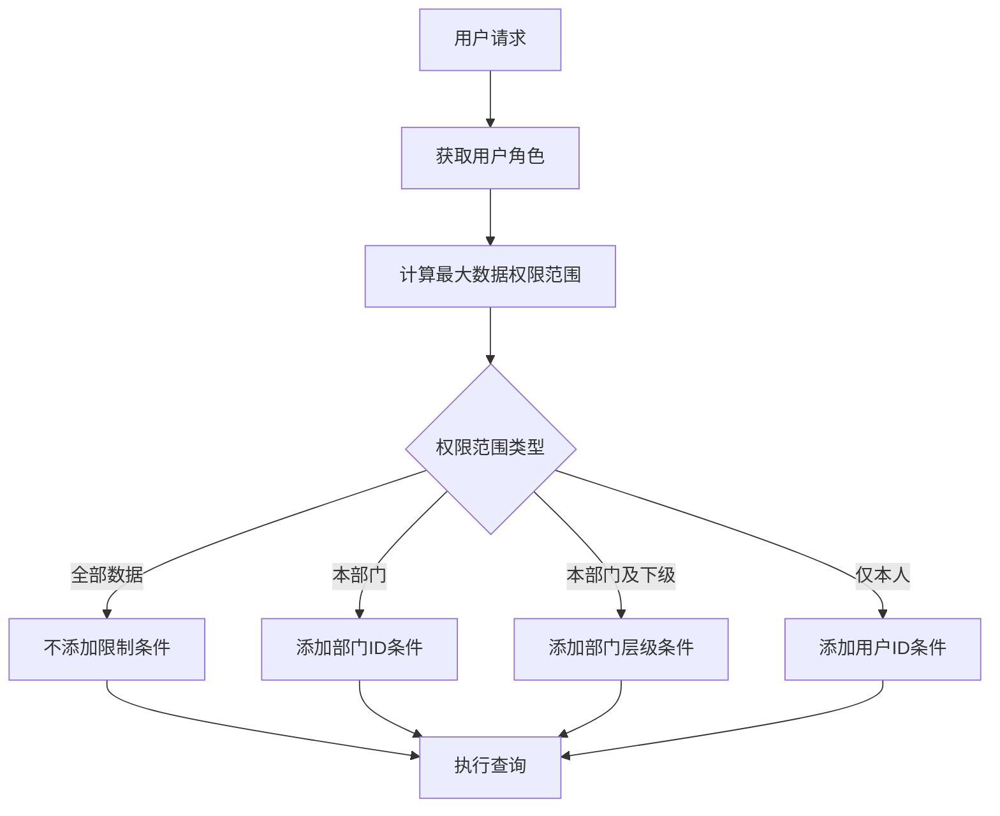

# RBAC权限管理系统技术实现文档

## 🎯 技术架构概览

### 整体架构设计

本RBAC权限管理系统采用经典的分层架构设计，确保代码的可维护性和扩展性：

```
┌─────────────────────────────────────────────────────────┐
│                    前端层 (Vue3 + Ant Design)             │
│               - 角色管理界面                               │
│               - 权限管理界面                               │  
│               - 用户角色管理界面                           │
├─────────────────────────────────────────────────────────┤
│                     API控制器层                          │
│    RoleController | PermissionController | UserController │
│               - REST API 接口                            │
│               - 参数验证和转换                             │
│               - 错误处理和响应格式化                        │
├─────────────────────────────────────────────────────────┤
│                     中间件层                             │
│        RBACMiddleware | DataScopeMiddleware              │
│               - 权限验证                                  │
│               - 数据权限过滤                               │
│               - 角色检查                                  │
├─────────────────────────────────────────────────────────┤
│                   业务逻辑层                              │
│    RoleService | PermissionService | UserService         │  
│               - 业务规则实现                               │
│               - 数据验证                                  │
│               - 事务管理                                  │
├─────────────────────────────────────────────────────────┤
│                   数据访问层                              │
│      RoleDao | PermissionDao | UserRoleDao               │
│               - 数据库操作                                │
│               - 查询优化                                  │
│               - 数据转换                                  │
├─────────────────────────────────────────────────────────┤
│                   数据模型层                              │
│  Role | Permission | User | UserRole | Department        │
│               - 数据结构定义                               │
│               - 关联关系                                  │
│               - 业务方法                                  │
└─────────────────────────────────────────────────────────┘
```

## 🗄️ 数据模型设计

### 核心实体关系图



### 权限模型设计

#### 权限类型 (PermissionType)
```go
const (
    PermissionTypeMenu   = 0  // 菜单权限 - 控制页面访问
    PermissionTypeButton = 1  // 按钮权限 - 控制操作按钮
    PermissionTypeAPI    = 2  // API权限 - 控制接口访问
    PermissionTypeData   = 3  // 数据权限 - 控制数据范围
)
```

#### 数据权限范围 (DataScope)
```go
const (
    DataScopeAll           = 1  // 全部数据权限
    DataScopeDepartment    = 2  // 本部门数据权限
    DataScopeDepartmentSub = 3  // 本部门及下级数据权限  
    DataScopeSelf          = 4  // 仅本人数据权限
)
```

## 🔧 核心功能实现

### 1. 角色管理系统

#### 层级角色结构
- **父子关系**: 支持多级角色层次
- **路径计算**: 自动维护层级路径 (如: /1/2/3/)
- **权限继承**: 子角色可继承父角色权限
- **循环检测**: 防止角色层级循环引用

#### 关键实现代码
```go
// 角色层级路径自动计算
func (r *Role) AfterCreate(tx *gorm.DB) error {
    if r.ParentID != nil {
        var parent Role
        if err := tx.First(&parent, *r.ParentID).Error; err != nil {
            return err
        }
        r.Path = parent.Path + "/" + string(rune(r.ID))
        r.Level = parent.Level + 1
    } else {
        r.Path = "/" + string(rune(r.ID))
        r.Level = 1
    }
    return tx.Model(r).Updates(map[string]interface{}{
        "path":  r.Path,
        "level": r.Level,
    }).Error
}
```

### 2. 权限验证机制

#### 多层权限验证
1. **URL级验证**: 基于请求路径和HTTP方法
2. **资源级验证**: 基于资源标识符和操作类型
3. **角色级验证**: 基于用户角色
4. **数据级验证**: 基于数据权限范围

#### RBAC中间件实现
```go
func RBACMiddleware(helper interfaces.HelperInterface) gin.HandlerFunc {
    return func(c *gin.Context) {
        userID := getUserID(c)
        path := c.Request.URL.Path
        method := c.Request.Method
        
        userService := service.NewUserService(helper.GetDatabase())
        hasPermission, err := userService.CheckUserURLPermission(userID, path, method)
        
        if !hasPermission {
            c.JSON(http.StatusForbidden, gin.H{
                "code": 403,
                "message": "没有访问权限",
            })
            c.Abort()
            return
        }
        c.Next()
    }
}
```

### 3. 数据权限控制

#### 动态权限过滤
- **查询拦截**: 自动在SQL查询中添加权限条件
- **范围计算**: 根据用户角色计算数据访问范围
- **部门层级**: 支持部门及其子部门数据访问

#### 数据权限应用示例
```go
func ApplyDataScope(db *gorm.DB, c *gin.Context, tableName string) *gorm.DB {
    dataScope := getDataScope(c)
    userID := getUserID(c)
    
    switch dataScope {
    case DataScopeAll:
        return db // 无限制
    case DataScopeDepartment:
        deptID := getUserDepartmentID(userID)
        return db.Where(tableName+".department_id = ?", deptID)
    case DataScopeSelf:
        return db.Where(tableName+".user_id = ?", userID)
    }
    return db
}
```

## 📡 API接口设计

### RESTful API规范

#### 角色管理接口
```
POST   /api/admin/roles                    - 创建角色
GET    /api/admin/roles                    - 角色列表 (支持分页、筛选)
GET    /api/admin/roles/tree               - 角色树形结构
GET    /api/admin/roles/:id                - 角色详情
PUT    /api/admin/roles/:id                - 更新角色
DELETE /api/admin/roles/:id               - 删除角色
PUT    /api/admin/roles/:id/status         - 更新角色状态
POST   /api/admin/roles/batch              - 批量操作
POST   /api/admin/roles/:id/permissions    - 分配权限
GET    /api/admin/roles/:id/permissions    - 获取角色权限
GET    /api/admin/roles/stats              - 角色统计
```

#### 权限管理接口
```
POST   /api/admin/permissions              - 创建权限
GET    /api/admin/permissions              - 权限列表
GET    /api/admin/permissions/tree         - 权限树形结构
GET    /api/admin/permissions/menu-tree    - 菜单树形结构
GET    /api/admin/permissions/:id          - 权限详情
PUT    /api/admin/permissions/:id          - 更新权限
DELETE /api/admin/permissions/:id         - 删除权限
PUT    /api/admin/permissions/:id/status   - 更新权限状态
POST   /api/admin/permissions/batch        - 批量操作
GET    /api/admin/permissions/stats        - 权限统计
```

#### 用户角色管理接口
```
POST   /api/admin/users/:id/roles/:roleId           - 分配角色
DELETE /api/admin/users/:id/roles/:roleId          - 移除角色
GET    /api/admin/users/:id/roles                   - 用户角色列表
GET    /api/admin/users/:id/with-roles              - 用户及角色信息
POST   /api/admin/users/:id/roles/batch             - 批量分配角色
DELETE /api/admin/users/:id/roles/batch            - 批量移除角色
PUT    /api/admin/users/:id/roles/:roleId/primary   - 设置主要角色
GET    /api/admin/users/:id/permissions             - 用户权限列表
GET    /api/admin/users/:id/menu-tree               - 用户菜单树
```

### 请求/响应格式规范

#### 统一响应格式
```json
{
  "code": 200,
  "message": "操作成功",
  "data": {
    // 具体数据
  }
}
```

#### 分页响应格式
```json
{
  "code": 200,
  "message": "查询成功", 
  "data": {
    "total": 100,
    "page": 1,
    "size": 20,
    "items": [
      // 数据列表
    ]
  }
}
```

#### 错误响应格式
```json
{
  "code": 400,
  "message": "请求参数错误",
  "data": null
}
```

## 🔐 安全机制

### 权限验证流程



### 数据权限计算



## ⚡ 性能优化

### 查询优化策略

1. **索引设计**
   - 用户角色关联表: (user_id, role_id)
   - 角色权限关联表: (role_id, permission_id)
   - 权限表: (type, status, parent_id)

2. **查询优化**
   - 预加载关联数据避免N+1查询
   - 批量查询减少数据库交互
   - 适当使用缓存提升性能

3. **数据权限优化**
   - 部门层级查询预计算
   - 用户权限缓存
   - 权限验证结果缓存

### 关键查询示例

#### 用户权限查询优化
```go
// 优化前: N+1查询
func GetUserPermissions(userID uint) ([]*Permission, error) {
    roles := getUserRoles(userID)
    var permissions []*Permission
    for _, role := range roles {
        rolePermissions := getRolePermissions(role.ID) // N次查询
        permissions = append(permissions, rolePermissions...)
    }
    return permissions, nil
}

// 优化后: 批量查询
func GetUserPermissions(userID uint) ([]*Permission, error) {
    var permissions []*Permission
    return permissions, db.Table("permissions").
        Joins("JOIN role_permissions ON permissions.id = role_permissions.permission_id").
        Joins("JOIN user_roles ON role_permissions.role_id = user_roles.role_id").
        Where("user_roles.user_id = ? AND user_roles.is_active = ?", userID, true).
        Group("permissions.id").
        Find(&permissions).Error
}
```

## 🧪 测试策略

### 单元测试
- DAO层数据库操作测试
- Service层业务逻辑测试
- Controller层API接口测试
- Middleware层权限验证测试

### 集成测试
- 完整的权限验证流程测试
- 数据权限过滤测试
- 角色权限分配测试
- 用户权限查询测试

### 测试用例示例
```go
func TestRoleService_CreateRole(t *testing.T) {
    tests := []struct {
        name    string
        request *dto.CreateRoleRequest
        wantErr bool
        errMsg  string
    }{
        {
            name: "创建正常角色",
            request: &dto.CreateRoleRequest{
                Name: "测试角色",
                Code: "test_role",
            },
            wantErr: false,
        },
        {
            name: "角色名称重复",
            request: &dto.CreateRoleRequest{
                Name: "已存在角色",
                Code: "existing_role",
            },
            wantErr: true,
            errMsg:  "角色名称已存在",
        },
    }
    
    for _, tt := range tests {
        t.Run(tt.name, func(t *testing.T) {
            result, err := roleService.CreateRole(tt.request)
            if tt.wantErr {
                assert.Error(t, err)
                assert.Contains(t, err.Error(), tt.errMsg)
            } else {
                assert.NoError(t, err)
                assert.NotNil(t, result)
            }
        })
    }
}
```

## 🚀 部署配置

### 数据库迁移
```go
// 自动迁移模型
func AutoMigrate(db *gorm.DB) error {
    return db.AutoMigrate(
        &model.Role{},
        &model.Permission{},
        &model.UserRole{},
        &model.RolePermission{},
    )
}
```

### 环境配置
```yaml
database:
  host: localhost
  port: 3306
  user: root
  password: password
  dbname: iam_system

redis:
  host: localhost
  port: 6379
  password: ""
  db: 0

security:
  jwt_secret: "your-jwt-secret"
  permission_cache_ttl: 3600
```

## 📊 监控指标

### 关键性能指标
- 权限验证平均响应时间
- 数据库查询执行时间
- 权限缓存命中率
- API接口调用频率

### 业务指标
- 活跃用户数量
- 角色分配数量
- 权限使用统计
- 数据权限覆盖率

---

**文档版本**: v1.0  
**更新时间**: 2025-10-10  
**适用版本**: IAM System v2.0+
